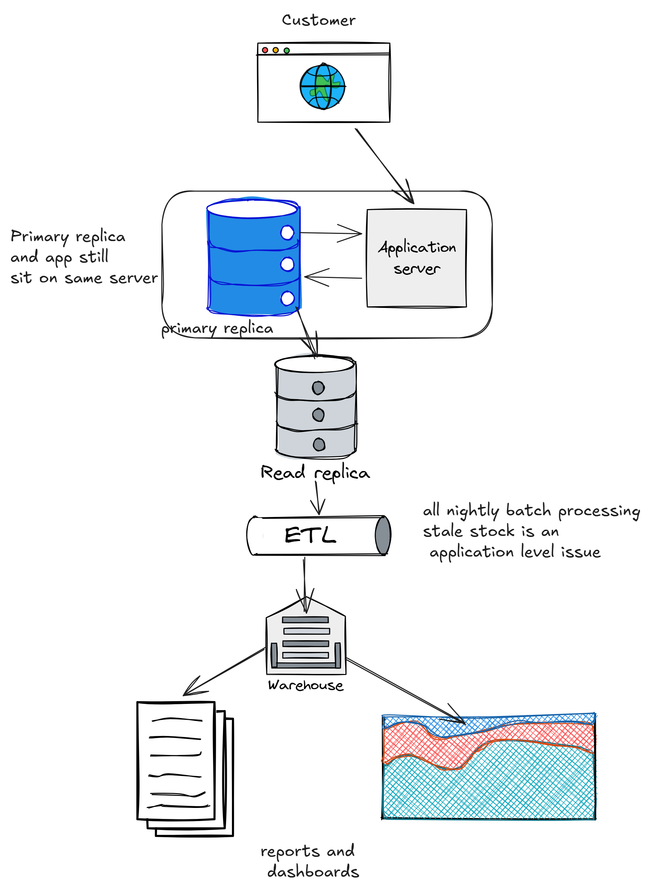

# Recommended Data Architecture – Kloud Kart Data Strategy Engagement

Kloud Kart should adopt a lightweight data warehouse hosted separately from its production environment, using a MySQL read replica as the preferred source for reporting extraction. This approach separates analytical workloads from customer-facing transactions while providing a central location for consistent reporting.

Storage – Data Warehouse: A data warehouse is recommended because Kloud Kart primarily manages structured data, including orders, customers and inventory. It supports centralised reporting and shared business definitions without introducing the additional complexity of a data lake or lakehouse.

Extraction – MySQL Read Replica: A read replica should receive changes from the production MySQL database and serve as the source for analytical extraction. This reduces the reporting query burden on the live website. Replication lag should be monitored, and the replica should not be used for live stock availability decisions.

Processing – ETL and Shared Business Rules: An ETL approach is recommended. Data will be extracted from the MySQL read replica, validated and transformed using centrally documented and agreed business rules before being loaded into the warehouse. These rules will define how key business measures are calculated across departments—for example, what qualifies as revenue, how refunds and cancelled orders are treated, and which dates determine reporting periods.

The agreed rules will be maintained in a shared, version-controlled transformation process rather than separate departmental spreadsheets. Finance and Operations will therefore use the same definitions and calculations when producing reports.

Loading Strategy – Full Load Followed by Incremental Batch: The initial warehouse population will use a full load of the historical records required for reporting. Subsequent scheduled batch runs will extract only new and changed records, using reliable change tracking and extraction checkpoints. A nightly schedule is sufficient for the initial reporting requirements.

Streaming – Not Required Initially: A separate streaming pipeline is not recommended at this stage. Live inventory must remain within the operational MySQL application, where stock availability is checked and updated through transactional controls during checkout. The warehouse will receive scheduled inventory data for analysis, but it will not control live stock availability.

Tool Categories: The architecture will require a relational database for the read replica, a data warehouse, ETL and extraction capabilities, scheduling and orchestration, data-quality monitoring, business intelligence and access-control and audit-logging capabilities.

The proposed architecture provides Kloud Kart with a practical foundation for its current reporting needs and anticipated 20% year-on-year growth. Introducing a MySQL read replica separates reporting extraction workloads from the live production database, reducing competition for resources and helping protect website performance as order volumes increase. The separate data warehouse provides a central, scalable environment for historical data, shared business definitions and consistent reporting across departments.
