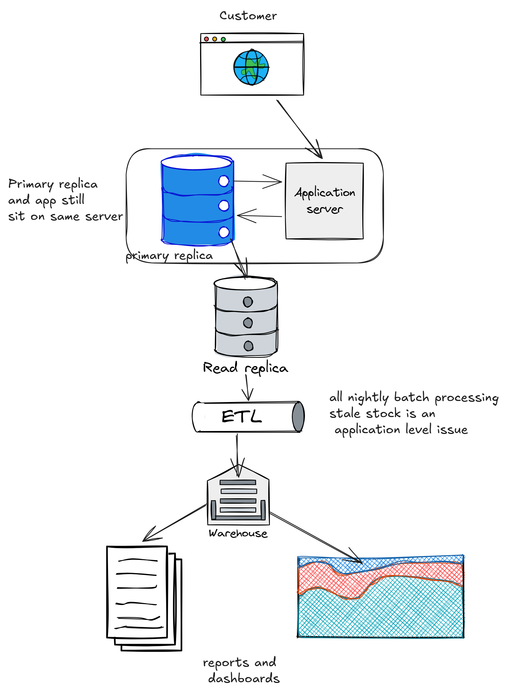

# Kloud Kart Data Strategy

  

This repository captures a practical data strategy engagement for Kloud Kart, a growing Ghana-based e-commerce business. The work focuses on building the right first data foundation for a company at its current size and maturity, rather than designing an oversized enterprise architecture.

## Project purpose

Kloud Kart is shipping around 4,000 orders per day and is facing the common early-stage data problems that appear when reporting, customer data, and operational systems all share the same MySQL database and box.

The project is designed to answer the decision the company actually needs to make:

- what to build first
- what to defer
- how to defend the decision in front of the board and investors
- which hires are required in the next 12 months
- how to protect the business while staying inside a realistic budget

## Repository structure

- `01-diagnosis.md` — situation diagnosis and root-cause analysis of the key operational and governance issues
- `02a-recommendation.md` — recommendation for the architecture and operating model
- `02b-roadmap.md` — 12-month roadmap with quarterly outcomes and checks
- `03-ADRs/` — architecture decision records covering the major trade-offs
- `kloud-kart-arch-v2.png` — supporting architecture diagram

## Core themes

The recommended direction is intentionally modest and defendable:

- separate reporting from the live transactional system using a MySQL read replica
- create a lightweight warehouse for reporting and shared definitions
- keep live stock logic inside the operational application
- define one shared revenue metric across Finance and Operations
- control customer-data exports and deletion processes to meet data protection obligations
- defer real-time dashboards and forecasting until the reporting foundation is stable

## Why this approach

This strategy is sized to Kloud Kart's actual context:

- one developer team with limited data experience
- one shared MySQL database and server
- modest data volume compared with enterprise-scale systems
- a need for board-ready recommendations, not theoretical architecture
- pressure to be defensible under Ghana's data protection requirements

## Delivery goals

The project aims to provide:

1. a situation diagnosis ranked by business risk
2. a clear recommendation for a realistic first implementation
3. a practical quarterly roadmap for the next 12 months
4. early decision records that explain why the chosen path is preferable to common alternatives
5. a credible board-level answer to investor pressure without overspending

## Key decision summary

The chosen path is to build a simple but durable reporting foundation first, rather than jumping to a modern lakehouse or enterprise cloud platform.

The first priority is to protect the live website, define trusted metrics, and control customer-data exports. Once those are in place, the business can add more advanced analytics where the evidence supports it.

## Related artifacts

- Architecture diagram: `kloud-kart-arch-v2.png`
- Recommendation: `02a-recommendation.md`
- Roadmap: `02b-roadmap.md`
- ADRs: `03-ADRs/`

## Note

This repository is a planning and strategy artifact, not an implementation codebase. It is intended to support board-level, investor-ready, and operational decision-making for Kloud Kart's data evolution.
